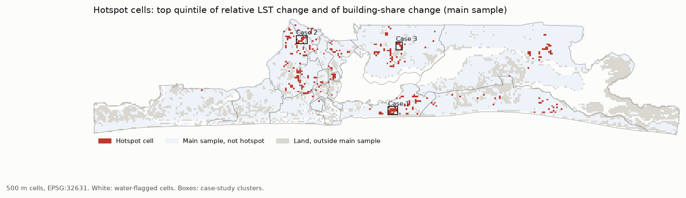
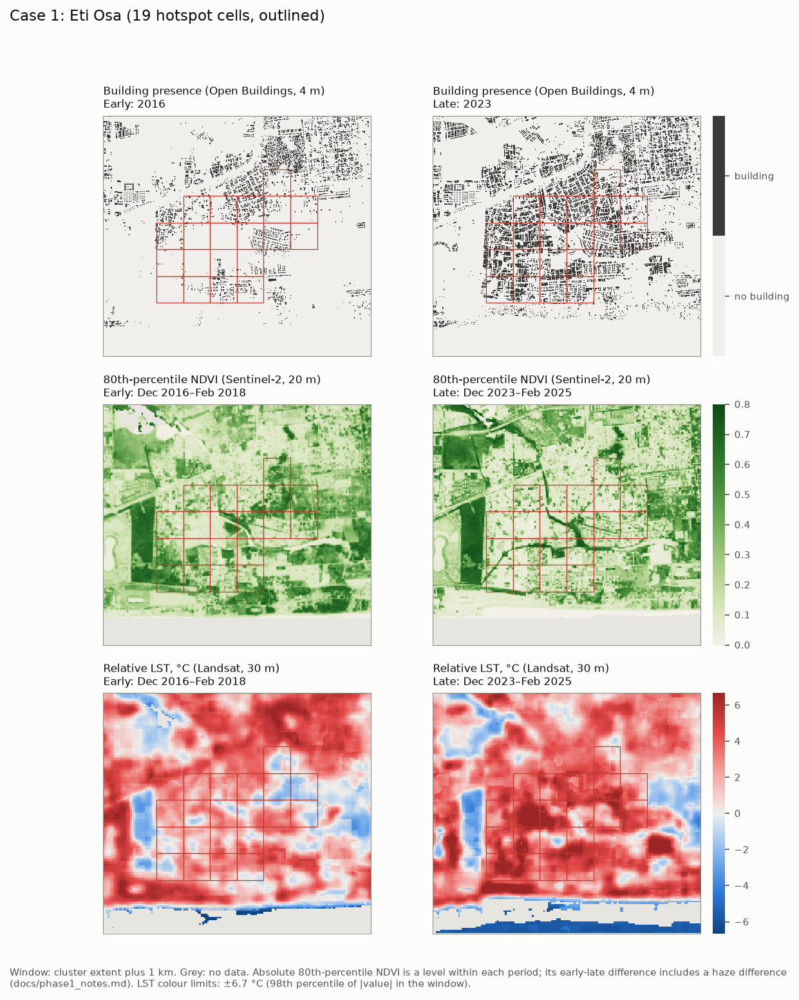
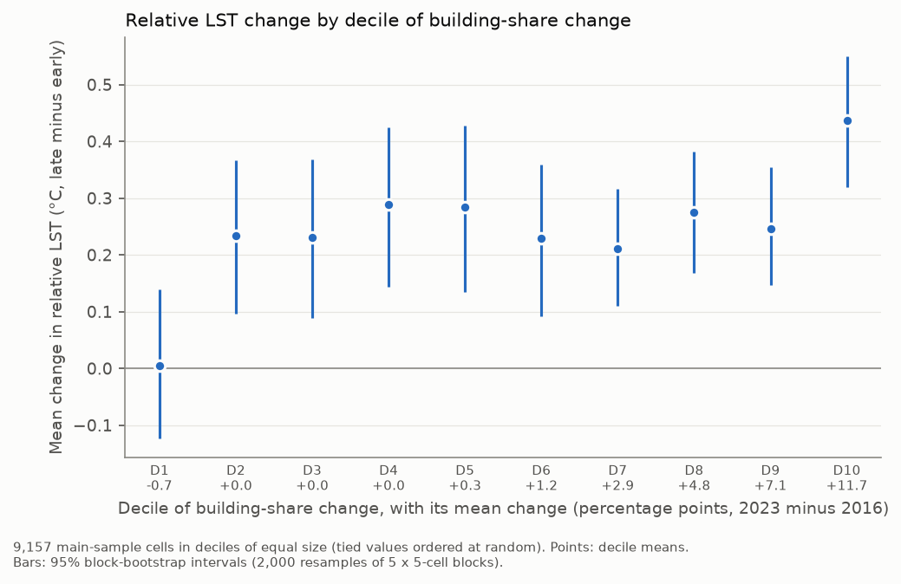

# Building out the breeze: building density, vegetation loss and surface heat in Lagos, 2016–2025

This project examines how changes in building density and vegetation cover relate to changes in dry-season land surface temperature across Lagos State. The unit of analysis is a grid of 500 m cells.

## Summary of findings

Across 9,157 cells, building share grew between 2016 and 2023. The more it grew in a cell, the more the cell warmed relative to the rest of Lagos between the dry seasons of 2016–18 and 2023–25: 0.579 °C of relative land surface temperature per 10 percentage points of building-share increase (95% interval 0.447 to 0.711). The association kept its sign in all 13 sensitivity runs.

Building growth went with vegetation loss. Adding vegetation change to the model reduced the building coefficient by about half (share 0.522). The association was weaker in cells already built up in 2016 (0.190 °C per 10 percentage points) than in mostly vegetated cells (0.731).

329 hotspot cells are in the top fifth of both building change and relative warming. By WorldPop 2023 estimates, they hold 896,165 residents, 8.5% of the main-sample total. Model residuals are strongly spatially autocorrelated (Moran's I 0.53 to 0.65), so the intervals may be too narrow.

These are associations in surface temperature, not causes or air temperature. The full results are in `docs/findings.md`, and a two-page brief for Lagos agencies is in `docs/policy_brief.md`.

## Key figures

Hotspot cells: the top quintile of both relative LST change and building-share change.



Case 1, Lekki Peninsula II (Chevron area), Eti-Osa: buildings, NDVI and relative LST, early and late periods.



Mean relative LST change by decile of building-share change, with block-bootstrap 95% intervals.



Priority-area maps: `figures/phase4/cool_now.png` and `figures/phase4/protect.png`.

## Documents

| File | Content |
|---|---|
| `docs/phase0_plan.md`, `docs/phase0_results.md` | Data access tests |
| `docs/phase1_notes.md` | Dataset construction and processing decisions |
| `docs/phase2_analysis_plan.md` | Analysis plan, fixed before results, with dated deviations |
| `docs/findings.md` | Final findings and limits (`docs/findings_draft.md` is the earlier draft) |
| `docs/phase3_validation.md`, `docs/phase3_spotcheck_instructions.md` | Validation: independent recompute, findings trace, imagery spot-check, case-study names |
| `docs/phase4_priority_rules.md` | Rules for the priority-area lists, fixed before ranking |
| `docs/policy_context.md` | Policy context with cited sources |
| `docs/policy_brief.md` | Two-page brief for Lagos agencies |
| `docs/data_sources.md` | Data sources, licences and attribution |

## How to reproduce

The environment is specified in `environment.yml` (conda) and `requirements.txt` (pip). Run each step from the repository root with `src` on the Python path (`PYTHONPATH=src`).

```
conda env create -f environment.yml
conda activate lagos-heat

# Phase 0: data access checks
python -m lagos_heat.phase0_check

# Phase 1: dataset (downloads; run one module at a time)
python -m lagos_heat.grid
python -m lagos_heat.population
python -m lagos_heat.buildings
python -m lagos_heat.temperature
python -m lagos_heat.vegetation        # downloads the per-date Sentinel-2 data
python -m lagos_heat.s2_haze
python -m lagos_heat.vegetation        # builds the composites from stored dates, then finalizes
python -m lagos_heat.vegetation_check
python -m lagos_heat.covariates
python -m lagos_heat.assemble

# Phase 2: analysis, figures and case-study maps
python -m lagos_heat.phase2 --skip-maps
python -m lagos_heat.phase2 --maps-only

# Phase 3: validation
python -m lagos_heat.validate --sample
python -m lagos_heat.validate --recompute
python -m lagos_heat.validate --spotcheck   # keeps hand-entered columns
python -m lagos_heat.validate --names

# Phase 4: priority areas
python -m lagos_heat.phase4

# Findings trace and tests
python -m lagos_heat.trace_findings
python -m pytest tests
```

The download steps read remote data over HTTP. They were run one at a time to keep memory use low. `docs/phase1_notes.md` describes each step and its outputs.

## Repository layout

```
data/raw         raw downloads (not tracked)
data/interim     intermediate tables and summaries (data/interim/summaries/*.json)
data/processed   analysis-ready rasters and result tables
docs             plans, notes, findings, brief
figures          figures by phase
src/lagos_heat   project code
tests            tests
```

## Data sources and licences

The data come from the following sources:

- Google Open Buildings 2.5D Temporal v1 (CC BY 4.0 or ODbL; CC BY 4.0 used)
- Sentinel-2 Level-2A (Copernicus Sentinel data terms; contains modified Copernicus Sentinel data 2016–2025)
- Landsat Collection 2 Level-2 (public domain, USGS)
- ESA WorldCover 2021 v200 (CC BY 4.0)
- JRC GHSL GHS-BUILT-S and GHS-POP R2023A (CC BY 4.0)
- WorldPop Global2 R2025A (CC BY 4.0)
- OpenStreetMap through Overpass and Nominatim (© OpenStreetMap contributors, ODbL 1.0)
- geoBoundaries gbOpen NGA ADM2 (CC BY 4.0)

Esri World Imagery Wayback was viewed for the spot-check only. Full licence statements, attribution text and citations are in `docs/data_sources.md`.

## Use of AI

The code in this repository is AI-assisted. It was written with Claude Code, an AI coding agent, under the author's direction, and committed by the author. The same agent ran the validation recompute and the findings trace in Phase 3. The imagery spot-check was a visual check by an AI assistant, blinded to the data, and a human reviewer confirmed its classification for 10 of the 40 cells rather than coding them independently. The policy facts in `docs/policy_context.md` were gathered by the agent from the cited sources.

## Limits

- The study measures land surface temperature, not air temperature.
- The results are associations between changes across cells, not causes.
- Building-change values are less reliable in cells already densely built in 2016.
- Spatial autocorrelation of residuals means the intervals may be too narrow.
- WorldPop population is modelled.
- The satellite data end in February 2025.
- The 2023/24 El Niño overlaps the first late dry season. Relative LST removes city-wide shifts, but not shifts that vary within the city.

Details are in `docs/findings.md`.

## Citation

Badmus, M. (2026). Building out the breeze: building density, vegetation loss and surface heat in Lagos, 2016–2025 [code and data analysis]. Please also cite the data sources listed in `docs/data_sources.md`.

## Licence

The code is released under the MIT License (`LICENSE`). Data products derived from the sources above remain subject to the source licences in `docs/data_sources.md`.
